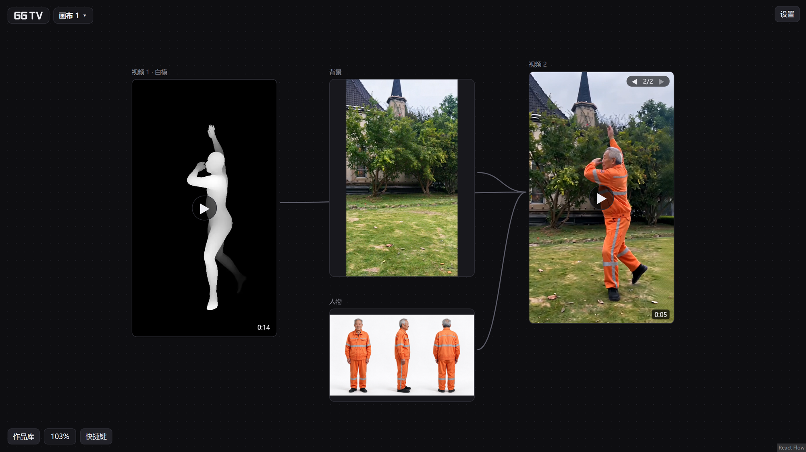

# GG TV · Motion-preserving AI video rewrite on an infinite canvas

[简体中文](README.md) · **English**

[](LICENSE) [](https://github.com/c2247189334/ggtv-canvas/actions/workflows/check.yml)

**Turn a 4–30 s clip into a new video — a different person, outfit or background — while keeping the original motion and timing.**
The motion reference (a depth map or a 3D body mesh) is computed on your own NVIDIA GPU for free. Image and video generation call Volcengine Ark (Seedream / Seedance) on your own account, with a cost estimate shown before every job. A 15-second 480p rewrite cost the author about ¥11.72. Everything runs on your own Windows machine; your API key and your works are stored only there.



**How it works:** source clip → local motion reference (Video-Depth-Anything Small depth map, or ComfyUI + SAM 3D Body mesh) → Doubao watches the clip and writes per-segment prompts → you swap in your own character, outfit and background images → Seedance generates the video → the original soundtrack is re-attached. Every step is a card on one infinite canvas, and connections are references.

**Good fit if** you want to restage an existing clip with your own characters and scenes, already use Volcengine Seedance / Seedream, and run Windows with an NVIDIA GPU.

**Not a fit if** you need many model providers (OpenAI, Gemini…), macOS / Linux, or an English UI. Without an NVIDIA GPU, image / video generation and the library still work, but video rewrite does not.

The UI is in Chinese. MIT licensed.

> **Preview 0.1.0.** The full pipeline has only been tested on one Windows 11 laptop with an RTX 5080 (16 GB VRAM). Reports from other GPUs and systems are welcome in [Issues](../../issues).

## Features

- **Video rewrite** — upload a clip; Doubao describes it and writes per-segment prompts; you swap in your own character, outfit and background images; the result is generated and the original soundtrack is re-attached.
- **Motion reference (optional, runs on your GPU, free)** — a depth map (Video-Depth-Anything Small) or a body mesh (ComfyUI + SAM 3D Body).
- **Infinite canvas** — multiple canvases; place image and video cards anywhere and connect them to use one as a reference for another.
- **Image generation / editing** — Seedream 5.0 (Flash / Lite).
- **Video generation** — Seedance 2.0 Mini / Fast / 2.0 / 2.5; images, videos and audio can all serve as references, and the estimated cost is shown before each job is submitted.
- **Library** — generated images, videos and audio are collected automatically and can be dragged back onto the canvas.
- **Video utilities** — extract the original soundtrack, trim a clip; a "rewrite for me" button asks Doubao to polish your prompt.

## Cost

Image generation, video generation and Doubao analysis call Volcengine Ark and are billed per use to **your own Volcengine account**. As measured by the author in November 2026, one 15-second 480p video rewrite cost about ¥11.72. Depth and body mesh run on your local GPU and cost nothing.

## Quick start (release bundle, recommended)

You need: Windows (tested on Windows 11 only), [Node.js](https://nodejs.org/) 22.12 or newer, ffmpeg (with ffprobe), a Volcengine Ark API key; using a video as a reference also needs a TOS bucket in the Beijing region.

1. Download `ggtv-canvas-<version>-win.zip` from [Releases](../../releases) and extract it completely into an ordinary folder.
2. Install ffmpeg: run `winget install Gyan.FFmpeg` in a terminal.
3. Copy `.env.example` to `.env.local` and fill in your Ark key and TOS settings.
4. Double-click `一键启动.bat` (one-click start). Your browser opens `http://127.0.0.1:5290`. When you are done, close the console window or double-click `停止.bat` (stop).

The start script never installs anything on its own; if something is missing it stops and tells you what. Step-by-step details, the optional depth / mesh installs and troubleshooting are in the **[installation guide](docs/安装说明.md)** (Chinese).

| Optional | Needs | How |
| --- | --- | --- |
| Depth | NVIDIA GPU, driver with CUDA 12.8+, about 15 GB free disk | double-click `安装深度.bat` (add `--cn` for a mirror in mainland China) |
| Body mesh | ComfyUI portable + 4 models (about 5.5 GB) | prepare by hand per the guide, then double-click `检查白模环境.bat` to check |

## Run from source (developers)

```bash
git clone https://github.com/c2247189334/ggtv-canvas.git
cd ggtv-canvas
npm ci
npm run typecheck   # type check
npm test            # all tests, web + local server (needs ffmpeg)
npm run fake        # fake Ark mode: free, no key needed, opens http://127.0.0.1:5291
npm run pack        # build the Windows release bundle into release/
npm run smoke       # smoke-test the bundle: extract, no install, start in fake mode
```

Day-to-day development: `npm run dev` (web, port 5280) and `npm start` (local server, port 5290) in two terminals. Every push runs type check, tests, packaging and the smoke test on a fresh Windows runner on GitHub (no GPU there, so real depth / mesh inference is not covered).

## Project layout

| Directory | Contents |
| --- | --- |
| `src/` | Web app: React 19 + [React Flow](https://reactflow.dev/) (`@xyflow/react`) + Vite |
| `server/` | Local server: Node built-in modules only, no third-party runtime dependency |
| `scripts/` | Packaging, smoke test, depth installer, mesh environment check |
| `docs/安装说明.md` | Full installation guide for end users (Chinese) |

## Security and privacy

- The local server binds `127.0.0.1` only; it is unreachable from the LAN or the internet, and it rejects requests from other websites.
- Keys live only in `.env.local`, which is ignored by Git; keys are masked in logs.
- Works, jobs and uploaded videos are stored in the local `数据/` folder.

See [SECURITY.md](SECURITY.md) for how to report a vulnerability.

## License and credits

The code is released under the [MIT License](LICENSE). The release bundle ships no models and no Python environment; you download the models yourself and must follow their licenses:

- Depth uses only the **Small** model of [Video-Depth-Anything](https://github.com/DepthAnything/Video-Depth-Anything) (Apache-2.0); Base / Large are non-commercial and are not used.
- Body mesh models: SAM 3.1 and SAM 3D Body are under Meta's SAM License, RT-DETR is Apache-2.0, MoGe is MIT (as labelled on Hugging Face on 2026-11-01); the release pages are authoritative.
- The web bundle includes React, React Flow and other open-source libraries; their notices are in `dist/THIRD_PARTY_LICENSES.md` inside the release bundle.
- Using Volcengine Ark is subject to Volcengine's terms of service and content policy. Do not generate content from another person's likeness without their consent.

Thanks to [ComfyUI](https://github.com/Comfy-Org/ComfyUI), [Video-Depth-Anything](https://github.com/DepthAnything/Video-Depth-Anything), [React Flow](https://github.com/xyflow/xyflow) and [Vite](https://github.com/vitejs/vite).
