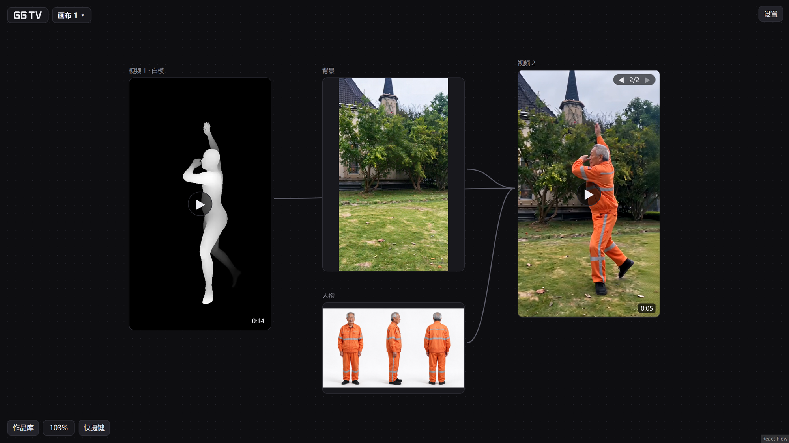

# GG TV · Motion-preserving AI video rewrite on an infinite canvas

[简体中文](README.md) · **English**

[](../../releases/latest) [](LICENSE) [](https://github.com/c2247189334/ggtv-canvas/actions/workflows/check.yml)

**Turn a 4–30 s clip into a new video — a different person, outfit or background — while keeping the original motion and timing.**

The motion reference (a depth map or a 3D body mesh) is computed on your own NVIDIA GPU for free. Image and video generation call Volcengine Ark (Seedream / Seedance) directly on your own account — pay only for what you use; a 15-second 480p rewrite cost the author about ¥11.72. Everything runs on your own Windows machine; your API key and your works are stored only there.

**[⬇ Download the latest release bundle (Windows)](../../releases/latest)**　The web app is prebuilt, no `npm install`: extract, fill in your key, double-click `一键启动.bat`.



**How it works:** source clip → local motion reference (Video-Depth-Anything Small depth map, or ComfyUI + SAM 3D Body mesh) → your local AI agent watches the clip and writes per-segment prompts → you swap in your own character, outfit and background images → Seedance generates the video → the original soundtrack is re-attached. Every step is a card on one infinite canvas, connections are references, and you can redo any single step.

## Highlights

- **Motion follows the source** — a depth map or 3D body mesh locks the original motion and timing, so the new person, outfit or background stays in sync.
- **An AI agent writes the prompts** — your local Claude Code / Codex breaks the clip down, writes per-segment prompts and checks them against the reference images and source frames, on your own subscription rather than Ark credit.
- **One canvas for the whole pipeline** — sources, intermediate results and outputs all live on the canvas; connections are references, and you can go back to any step.
- **Spending under control** — direct to Volcengine with no markup; every charge is recorded in a local ledger; a paid job whose reply got lost is re-attached to its card automatically, so you never pay twice.
- **Ready to run** — a Windows bundle you start with a double-click; if something is missing it stops and says what, and it never installs anything behind your back.
- **Well tested** — over 1,500 automated tests; every update runs type check, all tests, packaging and a start-up check on a fresh Windows runner.

## Features

- **Video rewrite** — upload a clip; your local AI agent describes it and writes per-segment prompts; you swap in your own character, outfit and background images; the result is generated and the original soundtrack is re-attached. Multi-location and two-person clips are supported.
- **Motion reference (optional, runs on your GPU, free)** — a depth map (Video-Depth-Anything Small) or a body mesh (ComfyUI + SAM 3D Body).
- **Infinite canvas** — multiple canvases; place image and video cards anywhere and connect them to use one as a reference for another; group cards with Ctrl+G.
- **Image generation / editing** — Seedream 5.0 (Flash / Lite).
- **Video generation** — Seedance 2.0 Mini / Fast / 2.0 / 2.5; images, videos and audio can all serve as references.
- **Library** — generated images, videos and audio are collected automatically and can be dragged back onto the canvas; "My uploads" keeps the images and videos you uploaded (one copy per file), and a "Characters" page stores reusable characters.
- **Video utilities** — extract the original soundtrack, trim a clip, capture a frame (current / first / last); a "rewrite for me" button asks your local AI agent to polish your prompt.
- **Product remake (no person)** — for product clips that only show hands or feet: say what to swap, and the product group and a new video card are laid out with the source clip as the reference. No GPU needed.

See the [CHANGELOG](CHANGELOG.md) for what each version added or changed.

## Requirements

- **OS**: Windows.
- **GPU**: the motion reference for video rewrite needs an NVIDIA GPU (driver with CUDA 12.8+); without one you can still generate images and videos, use the library and run product remake.
- **Model service**: Volcengine Ark (Seedream / Seedance) with your own API key.
- **UI language**: Chinese.

## Local AI agent (Claude Code / Codex built in, pluggable)

Clip analysis, image lookups and prompt writing for video rewrite and product remake, plus "rewrite for me", run through the AI coding agent on your machine, using your own subscription rather than Ark credit. Plain image and video generation do not need it.

- **Built in**: Claude Code (default; the copy bundled with the Claude desktop app is detected too) and Codex (set `AGENT_ENGINE=codex` in `.env.local`).
- **Pluggable**: to add another command-line agent, write one adapter modelled on `server/codex.mjs` and register it in `server/agent.mjs`. Pull requests are welcome.
- **Setup**: run `claude` (or `codex login`) once in a terminal and sign in with your own account. Only the `.exe` builds work; an npm-installed `.cmd` cannot be launched. If it is not set up, those buttons show a dialog explaining what is missing.
- GG TV only launches the agent on your machine; it never reads, stores or forwards your credentials.

## Cost

Image generation and video generation call Volcengine Ark and are billed per use to **your own Volcengine account**, with no markup in between. As measured by the author in November 2026, one 15-second 480p video rewrite cost about ¥11.72. Depth and body mesh run on your local GPU, and the AI agent uses your own subscription, so neither adds any cost.

## Tips

- **Send submits a paid job right away** (so does Ctrl+Enter); check the prompt and settings first. If a card says a task "may have been created", check the task list in the Volcengine console before resending.
- **Keep reference videos under 64 MB** for the most reliable uploads.
- **Clean up reference videos in TOS from time to time**: the read link expires after 24 hours, but the file stays in your own bucket until you delete it in the Volcengine console or add a lifecycle rule.

Bug reports are welcome in [issues](https://github.com/c2247189334/ggtv-canvas/issues); please include the raw error from the console window.

## Quick start (release bundle, recommended)

You need: Windows, [Node.js](https://nodejs.org/) 22.12 or newer, ffmpeg (with ffprobe), a Volcengine Ark API key; using a video as a reference also needs a TOS bucket in the Beijing region; video rewrite, product remake and "rewrite for me" also need the local AI agent set up (see above).

1. Download `ggtv-canvas-<version>-win.zip` from the [latest release](../../releases/latest) (not "Source code") and extract it completely into an ordinary folder.
2. Install ffmpeg: run `winget install Gyan.FFmpeg` in a terminal.
3. Copy `.env.example` to `.env.local` and fill in your Ark key and TOS settings.
4. Double-click `一键启动.bat` (one-click start). Your browser opens `http://127.0.0.1:5290`. When you are done, close the console window or double-click `停止.bat` (stop).

The start script never installs anything on its own; if something is missing it stops and tells you what. Step-by-step details, the optional depth / mesh installs and troubleshooting are in the **[installation guide](docs/安装说明.md)** (Chinese).

| Optional | Needs | How |
| --- | --- | --- |
| Depth | NVIDIA GPU, driver with CUDA 12.8+, about 15 GB free disk | double-click `安装深度.bat` (for a mainland-China mirror, see the `--cn` usage in the guide) |
| Body mesh | ComfyUI portable + 4 models (about 5.5 GB) | prepare by hand per the guide, then double-click `检查白模环境.bat` to check |

## Run from source (developers)

```bash
git clone https://github.com/c2247189334/ggtv-canvas.git
cd ggtv-canvas
npm ci
npm run typecheck   # type check
npm test            # all tests, web + local server (needs ffmpeg)
npm run fake        # fake Ark mode: free, no key needed, opens http://127.0.0.1:5291
npm run pack        # build the Windows release bundle into release/
npm run smoke       # smoke-test the bundle: extract, no install, start in fake mode
```

Day-to-day development: `npm run dev` (web, port 5280) and `npm start` (local server, port 5290) in two terminals. Every push runs type check, tests, packaging and the smoke test on a fresh Windows runner on GitHub (no GPU there, so real depth / mesh inference is not covered).

## Project layout

| Directory | Contents |
| --- | --- |
| `src/` | Web app: React 19 + [React Flow](https://reactflow.dev/) (`@xyflow/react`) + Vite |
| `server/` | Local server: Node built-in modules only, no third-party runtime dependency |
| `scripts/` | Packaging, smoke test, depth installer, mesh environment check |
| `docs/安装说明.md` | Full installation guide for end users (Chinese) |

## Security and privacy

- The local server binds `127.0.0.1` only; it is unreachable from the LAN or the internet, and it rejects requests from other websites.
- Keys live only in `.env.local`, which is ignored by Git; keys are masked in logs.
- Works, jobs and uploaded videos are stored in the local `数据/` folder.
- What leaves your machine: for image and video generation, prompts and reference images / videos go to Volcengine (reference videos via your own TOS bucket); for video rewrite, product remake and "rewrite for me", frames from the clip, connected images and prompts are handed to the AI agent on your machine, which sends them to its model service under your own account (Claude Code → Anthropic, Codex → OpenAI).

See [SECURITY.md](SECURITY.md) for how to report a vulnerability, [CONTRIBUTING.md](CONTRIBUTING.md) to take part, and [CHANGELOG.md](CHANGELOG.md) for version history.

## License and credits

Versions after 0.1.0 are released under the [PolyForm Noncommercial License 1.0.0](LICENSE); the full text in LICENSE is what counts:

- Free for personal study, research, hobby projects and other noncommercial purposes. You may share and modify it free of charge if you keep the copyright notice and the license text.
- **Images and videos an individual generates with it on their own computer are theirs to handle: they may publish them and earn money from them** (the author's additional permission at the top of LICENSE).
- **The software itself may not be used commercially without the author's written permission**: no selling, paid distribution, paid listings or paid services, and a company using it in its business needs permission too. To ask, [open an issue](https://github.com/c2247189334/ggtv-canvas/issues).
- Version 0.1.0, already released, stays under the MIT License it shipped with.
- This license covers only GG TV's own code and workflow. ComfyUI, Video-Depth-Anything, the models and Volcengine Ark keep their own licenses and terms.
- The GG TV name and logo are not licensed. If you publish a modified version, rename it and do not imply it is official.
- Made by chen guo tongxue. The only official home is https://github.com/c2247189334/ggtv-canvas .

The release bundle ships no models and no Python environment; you download the models yourself and must follow their licenses:

- Depth uses only the **Small** model of [Video-Depth-Anything](https://github.com/DepthAnything/Video-Depth-Anything) (Apache-2.0); Base / Large are non-commercial and are not used.
- Body mesh models: SAM 3.1 and SAM 3D Body are under Meta's SAM License, RT-DETR is Apache-2.0, MoGe is MIT (as labelled on Hugging Face on 2026-11-01); the release pages are authoritative.
- The web bundle includes React, React Flow and other open-source libraries; their notices are in `dist/THIRD_PARTY_LICENSES.md` inside the release bundle.
- Using Volcengine Ark is subject to Volcengine's terms of service and content policy. Do not generate content from another person's likeness without their consent.

Thanks to [ComfyUI](https://github.com/Comfy-Org/ComfyUI), [Video-Depth-Anything](https://github.com/DepthAnything/Video-Depth-Anything), [React Flow](https://github.com/xyflow/xyflow) and [Vite](https://github.com/vitejs/vite).
