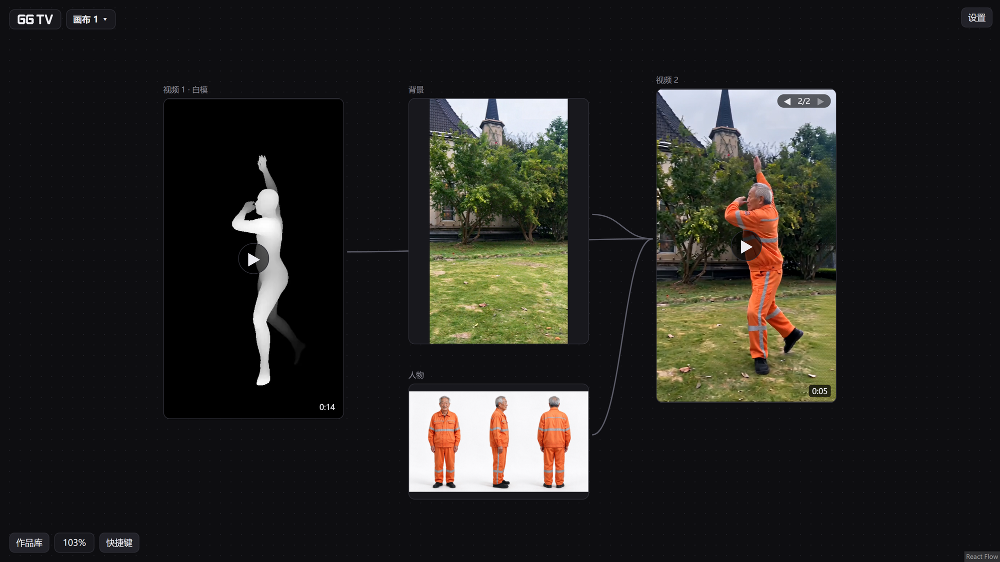

# GG TV · 保留动作的 AI 视频改写（无限画布 · 火山 Seedance）

**简体中文** · [English](README.en.md)

[](LICENSE) [](https://github.com/c2247189334/ggtv-canvas/actions/workflows/check.yml)

**把一段 4–30 秒的视频换人、换衣服、换背景，动作和节奏跟着原片走。**
动作参考（深度图或 3D 白模）在你自己的 NVIDIA 显卡上算，不花钱；出图、出视频调用火山引擎 Seedream / Seedance，费用从你自己的火山账号扣，交单前先显示预估费用。作者实测一条 15 秒 480P 的改写约 ¥11.72。全部在你自己的 Windows 电脑上运行，密钥和作品都只存在本机。

> **English** — GG TV (`ggtv-canvas`) does motion-preserving AI video rewrite on a local, Windows-first infinite canvas: turn a 4–30 s clip into a new video with a different person, outfit or background while keeping the original motion. The motion reference is a local depth map (Video-Depth-Anything Small) or a 3D body mesh (ComfyUI + SAM 3D Body); generation uses Volcengine Ark models (Seedream 5.0, Seedance 2.0 / 2.5, Doubao Seed). The UI is in Chinese. Free for noncommercial use (PolyForm Noncommercial 1.0.0). Individuals may publish and monetize what they generate.



**怎么做到的：** 原片 → 本机算出动作参考（深度图 / 白模）→ 豆包看懂原片、写好分段提示词 → 换上你的人物、衣服、背景图 → Seedance 生成 → 自动配回原声。每一步的图和视频都是画布上的一张卡，连线就是参考关系。

**适合你，如果：**

- 想把现成视频（舞蹈、动作片段）换成自己设计的人物和场景，同时保留原动作；
- 已经在用火山引擎 Seedance / Seedream，想要一个本机运行、花多少钱看得见的画布；
- 用 Windows，有 NVIDIA 显卡。

**可能不适合你，如果：**

- 想要能接很多家模型（OpenAI、Gemini 等）的通用画布：本项目只接火山引擎；
- 用 macOS / Linux：目前只支持 Windows；
- 没有 NVIDIA 显卡：出图、出视频、作品库照样能用，但视频改写用不了；
- 需要英文界面：目前界面是中文。

**当前是预览版 0.1.0。** 完整流程只在一台 Windows 11 + RTX 5080 笔记本（16 GB 显存）上测过，别的显卡和系统欢迎[提问题](../../issues)反馈。

## 能做什么

- **视频改写**：上传一段视频，豆包看懂内容、写好分段提示词，你换上自己的人物、衣服、背景图，生成后自动配回原声。
- **动作参考（选装，用本机显卡算，不花钱）**：深度图（Video-Depth-Anything Small）或白模（ComfyUI + SAM 3D Body）。
- **无限画布**：多张画布，图片卡、视频卡随便摆，连线就能当参考。
- **出图 / 改图**：Seedream 5.0（Flash / Lite）。
- **出视频**：Seedance 2.0 Mini / Fast / 2.0 / 2.5；图片、视频、声音都能当参考，交单前先显示预估费用。
- **作品库**：生成的图、视频、声音自动入库，能拖回画布接着用。
- **视频小工具**：提取原声、片段截取；写提示词时可以点「帮我改写」让豆包润色。

## 花费说明

出图、出视频、豆包分析都调用火山方舟，按量计费，费用从**你自己的火山账号**扣。作者 2026-11 实测：一条 15 秒 480P 的视频改写约 ¥11.72。深度和白模在本机显卡上算，不产生费用。

## 快速开始（整合包，推荐）

需要：Windows（只在 Windows 11 上测过）、[Node.js](https://nodejs.org/) 22.12 或以上、ffmpeg（带 ffprobe）、火山方舟 API Key；用视频当参考还需要一个北京区的 TOS 桶。

1. 到 [Releases](../../releases) 下载 `ggtv-canvas-版本号-win.zip`，完整解压到一个普通文件夹。
2. 装 ffmpeg：在终端运行 `winget install Gyan.FFmpeg`。
3. 把 `.env.example` 复制一份改名为 `.env.local`，填上自己的火山方舟密钥和 TOS 配置。
4. 双击 `一键启动.bat`，浏览器会打开 `http://127.0.0.1:5290`。用完关掉黑窗口，或双击 `停止.bat`。

启动脚本不会自动安装任何东西，缺什么会停下来说清楚。每一步的细节、深度和白模的选装、常见问题，都在 **[安装说明](docs/安装说明.md)**。

| 选装 | 需要 | 怎么装 |
| --- | --- | --- |
| 深度 | NVIDIA 显卡、驱动支持 CUDA 12.8+、约 15 GB 空闲硬盘 | 双击 `安装深度.bat`（国内网络加 `--cn`） |
| 白模 | ComfyUI 便携版 + 4 个模型（约 5.5 GB） | 按安装说明手动准备，双击 `检查白模环境.bat` 体检 |

## 从源码运行（开发者）

```bash
git clone https://github.com/c2247189334/ggtv-canvas.git
cd ggtv-canvas
npm ci
npm run typecheck   # 类型检查
npm test            # 页面 + 小服务全部测试（要装 ffmpeg）
npm run fake        # 假火山模式：不花钱、不需要密钥，打开 http://127.0.0.1:5291
npm run pack        # 打 Windows 整合包到 release/
npm run smoke       # 整合包冒烟测试：解压、不装依赖、假火山启动
```

日常开发：`npm run dev`（页面，端口 5280）和 `npm start`（小服务，端口 5290）各开一个终端。每次推送，GitHub 会在一台全新的 Windows 云电脑上自动跑一遍类型检查、测试、打包和冒烟测试（云电脑没有显卡，深度和白模的真实推理测不到）。

## 项目结构

| 目录 | 内容 |
| --- | --- |
| `src/` | 页面：React 19 + [React Flow](https://reactflow.dev/)（`@xyflow/react`）+ Vite |
| `server/` | 本机小服务：只用 Node 自带模块，没有第三方运行依赖 |
| `scripts/` | 打包、冒烟测试、深度安装、白模体检 |
| `docs/安装说明.md` | 给普通用户的完整安装说明 |

## 安全和隐私

- 小服务只绑 `127.0.0.1`，局域网和外网都访问不到；还会拦截其他网站发来的请求。
- 密钥只放在 `.env.local`，它已被 `.gitignore` 排除，不会进版本库；日志里的密钥会打码。
- 作品、任务、上传的视频都存在本机 `数据/` 文件夹。

发现安全漏洞请按 [SECURITY.md](SECURITY.md) 私下报告；想参与开发看 [CONTRIBUTING.md](CONTRIBUTING.md)，版本变化见 [CHANGELOG.md](CHANGELOG.md)。

## 许可与致谢

本项目从 0.1.0 之后的版本起使用 [PolyForm Noncommercial License 1.0.0](LICENSE)，具体条款以 LICENSE 全文为准：

- 可以免费用于个人学习、研究、爱好等非商业用途，也可以在保留版权声明和许可全文的前提下免费转发、修改。
- **个人在自己电脑上用本软件生成的图片和视频，由使用者自行处理，可以发布，也可以用来赚钱**（LICENSE 开头的作者额外许可）。
- **软件本身未经作者书面授权禁止商业使用**：不得出售、收费分发、收费上架或做成收费服务，公司在业务中使用也需要授权。想商用请先[开 issue](https://github.com/c2247189334/ggtv-canvas/issues) 联系作者。
- 已经发布的 0.1.0 仍按当时的 MIT 许可。
- 这份许可只管 GG TV 自己的代码和整合流程；ComfyUI、Video-Depth-Anything、各模型和火山方舟都按各自的协议和条款。
- 「GG TV」名称和标志不在授权范围内，改版发布请换名字，不得暗示是官方版本。
- 作者 chen guo tongxue，官方地址只有 https://github.com/c2247189334/ggtv-canvas 。

整合包不带任何模型和 Python 环境，模型由你自己下载，请遵守各自的许可：

- 深度只用 [Video-Depth-Anything](https://github.com/DepthAnything/Video-Depth-Anything) 的 **Small** 模型（Apache-2.0）；Base / Large 是非商用许可，本项目不用。
- 白模用到的模型：SAM 3.1、SAM 3D Body 是 Meta 的 SAM License，RT-DETR 是 Apache-2.0，MoGe 是 MIT（2026-11-01 按 Hugging Face 页面标注），以各自发布页为准。
- 页面打包了 React、React Flow 等开源库，它们的许可声明在整合包的 `dist/THIRD_PARTY_LICENSES.md`。
- 使用火山方舟需遵守火山引擎的服务条款和内容规范。请勿用他人肖像生成未经本人同意的内容。

感谢 [ComfyUI](https://github.com/Comfy-Org/ComfyUI)、[Video-Depth-Anything](https://github.com/DepthAnything/Video-Depth-Anything)、[React Flow](https://github.com/xyflow/xyflow) 和 [Vite](https://github.com/vitejs/vite)。
