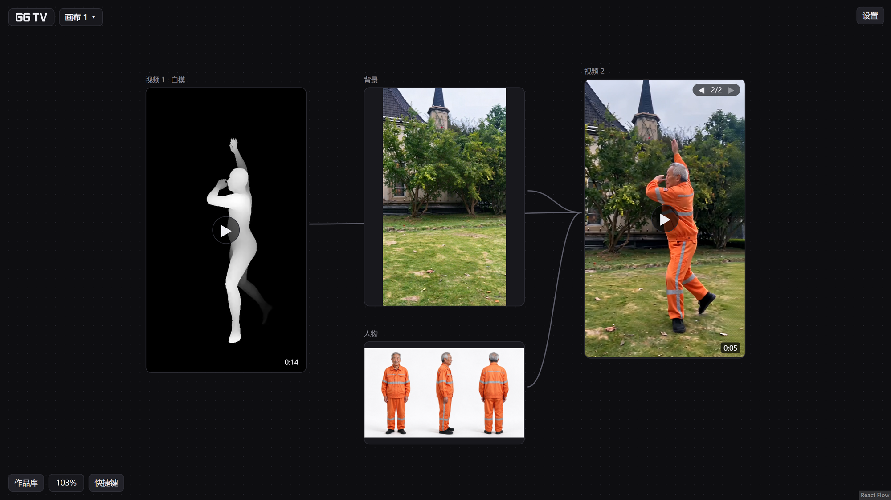

# GG TV · 保留动作的 AI 视频改写（无限画布 · 火山 Seedance）

**简体中文** · [English](README.en.md)

[](../../releases/latest) [](LICENSE) [](https://github.com/c2247189334/ggtv-canvas/actions/workflows/check.yml)

**把一段 4–30 秒的视频换人、换衣服、换背景，动作和节奏跟着原片走。**

动作参考（深度图或 3D 白模）在你自己的 NVIDIA 显卡上算，不花钱；出图、出视频直连火山引擎 Seedream / Seedance，按量付费、用多少花多少，作者实测一条 15 秒 480P 的改写约 ¥11.72。整套工具跑在你自己的 Windows 电脑上，密钥和作品都只存在本机。

**[⬇ 下载最新整合包（Windows）](../../releases/latest)**　页面已经打包好，不用 `npm install`：解压、填密钥、双击 `一键启动.bat` 就能用。

**🤖 让 AI 助手帮你装**　把下面这句话发给你的 AI 助手（Claude Code、Codex、Cursor 等），它会照 [给 AI 助手的安装说明](docs/AI助手安装说明.md) 一步步装好；密钥不用给它，装完你自己在页面右上角「设置」里填：

```text
帮我安装 https://github.com/c2247189334/ggtv-canvas ，严格按仓库里 docs/AI助手安装说明.md 的步骤做，装完用大白话告诉我怎么打开。
```

**[📖 使用教程](docs/使用教程.md)**　装好以后怎么用：5 分钟出第一张图、一步步走一遍视频改写、不看说明不知道的规矩。

> **English** — GG TV (`ggtv-canvas`) does motion-preserving AI video rewrite on a local, Windows-first infinite canvas: turn a 4–30 s clip into a new video with a different person, outfit or background while keeping the original motion. The motion reference is a local depth map (Video-Depth-Anything Small) or a 3D body mesh (ComfyUI + SAM 3D Body); generation uses Volcengine Ark models (Seedream 5.0, Seedance 2.0 / 2.5); clip analysis and prompt writing run through a local AI agent (Claude Code and Codex built in, pluggable for others). The UI is in Chinese. Free for noncommercial use (PolyForm Noncommercial 1.0.0). Individuals may publish and monetize what they generate.



**怎么做到的：** 原片 → 本机算出动作参考（深度图 / 白模）→ 你电脑上的 AI 助手看懂原片、写好分段提示词 → 换上你的人物、衣服、背景图 → Seedance 生成 → 自动配回原声。每一步的图和视频都是画布上的一张卡，连线就是参考关系，哪一步不满意就改哪一步。

## 亮点

- **动作跟着原片走**：用深度图或 3D 白模锁住原片的动作和节奏，换人、换装、换背景后照样对得上。
- **AI 助手帮你写提示词**：本机 Claude Code / Codex 自动拆解原片、分段写词，再对照参考图和原片截图核对一遍，用你自己的订阅额度，不花火山的钱。
- **一张画布管全流程**：素材、中间结果、成片都在画布上，连线即引用，随时回头改某一步。
- **花钱有底**：直连火山、没有中间商；每笔费用记在本机账本；交单回话丢了的付费单会自动接回卡片，不会让你重复花钱。
- **开箱即用**：Windows 整合包双击启动，缺什么会停下来用大白话说清楚，不会偷偷装东西。
- **测试扎实**：1500 多条自动测试；每次更新都在一台全新的 Windows 云电脑上自动跑类型检查、全部测试、打包和启动检查。

## 能做什么

- **视频改写**：上传一段视频，本机 AI 助手看懂内容、写好分段提示词，你换上自己的人物、衣服、背景图，生成后自动配回原声；支持原片里换地方、两个人同框。
- **动作参考（选装，用本机显卡算，不花钱）**：深度图（Video-Depth-Anything Small）或白模（ComfyUI + SAM 3D Body）。
- **无限画布**：多张画布，图片卡、视频卡随便摆，连线就能当参考；卡片可以打组（Ctrl+G）。
- **出图 / 改图**：Seedream 5.0（Flash / Lite）。
- **图层分离**：把一张图拆成底图和几个透明图层，拖动、缩放、旋转、翻转，能加进别的图拆出来的图层，也能让 AI 单独重画某一层，摆好后合并成一张新图。
- **出视频**：Seedance 2.0 Mini / Fast / 2.0 / 2.5；图片、视频、声音都能当参考。
- **作品库**：生成的图、视频、声音自动入库，能拖回画布接着用；「我上传的」留着你从电脑传过的图和视频，同一个文件只存一份；「人物」页能把图存为人物反复用。
- **视频小工具**：提取原声、片段截取、视频截图（当前帧 / 首帧 / 尾帧）；写提示词时点「帮我改写」让本机 AI 助手润色。
- **拆解（无人物）**：只拍商品和手脚、不露脸的带货视频，写一句要换什么，自动铺好商品组和新视频卡，原视频直接当参考，不需要显卡。

每个版本加了什么、改了什么，见 [CHANGELOG](CHANGELOG.md)。

## 运行环境

- **系统**：Windows。
- **显卡**：视频改写的动作参考要 NVIDIA 显卡（驱动支持 CUDA 12.8+）；没有独显也能出图、出视频、用作品库和拆解（无人物）。
- **模型服务**：火山引擎方舟（Seedream / Seedance），用你自己的 API Key。
- **界面**：中文。

## 本机 AI 助手（内置 Claude Code / Codex，可扩展）

视频改写和拆解（无人物）的看视频、看图、写提示词，以及「帮我改写」，交给你电脑上的 AI 编程助手完成，用你自己账号的订阅额度，不花火山的钱。只出图、出视频用不到它。

- **内置支持**：Claude Code（默认；Claude 桌面版自带的那份也能认到）和 Codex（在 `.env.local` 填 `AGENT_ENGINE=codex`）。
- **可扩展**：对接层是插件式的，接别的命令行 Agent 只要照着 `server/codex.mjs` 写一个适配文件、在 `server/agent.mjs` 里登记一行，欢迎提 PR。
- **怎么接**：装好后在终端运行一次 `claude`（或 `codex login`），用你自己的账号登录。只认 `.exe` 版，用 npm 装出来的 `.cmd` 启动不了。没接好时点这些按钮会弹框说明缺什么。
- 本项目只是启动你电脑上的 AI 助手，不读、不存、也不转交你的登录信息。

## 花费说明

出图、出视频调用火山方舟，按量计费，费用从**你自己的火山账号**扣，中间没有任何加价。作者 2026-11 实测：一条 15 秒 480P 的视频改写约 ¥11.72。深度和白模在本机显卡上算，AI 助手用你自己的订阅额度，都不产生额外费用。

## 使用小贴士

一步步怎么操作、每个按钮和勾选项是什么意思，见 **[使用教程](docs/使用教程.md)**。这里只列三条最容易花冤枉钱的：

- **点「发送」就会交单计费**（Ctrl+Enter 同样），发之前看一眼提示词和设置。卡片显示「可能已建任务」时，先去火山控制台的任务列表看一眼再决定要不要重发。
- **参考视频建议压到 64MB 以内**，上传更稳。
- **TOS 里的参考视频记得定期清**：读取链接 24 小时过期，文件还留在你自己的 TOS 桶里，可以到火山控制台手动删，或者给桶配一条生命周期规则自动清。

遇到问题欢迎[开 issue](https://github.com/c2247189334/ggtv-canvas/issues)，请附上黑窗口里的原始报错。

## 快速开始（整合包，推荐）

需要：Windows、[Node.js](https://nodejs.org/) 22.12 或以上。出图、出视频要火山方舟 API Key；用视频当参考还要一个北京区的 TOS 桶；截取、截帧、提取原声、深度和视频改写要 ffmpeg（带 ffprobe）；视频改写、拆解和「帮我改写」还要接好本机 AI 助手（见上面）。这些没备齐也能先打开画布用别的功能，用到哪一步才会提示。

1. 到 [Releases 最新版](../../releases/latest) 下载 `ggtv-canvas-版本号-win.zip`（不是下面的 Source code），完整解压到一个普通文件夹。
2. 装 ffmpeg（可以晚点再装）：在终端运行 `winget install Gyan.FFmpeg`。
3. 双击 `一键启动.bat`，浏览器会打开 `http://127.0.0.1:5290`。用完关掉黑窗口，或双击 `停止.bat`。
4. 点页面右上角「设置」，填上自己的火山方舟 Key 和 TOS 配置，点保存，不用重启。还没有 Key 的话，设置里的「怎么拿 Key」有步骤；设置下面的功能清单会告诉你每个功能能不能用、还缺什么。

启动脚本不会自动安装任何东西：缺 Node 或页面会停下来说清楚；缺 ffmpeg 只提醒，照常启动。每一步的细节、深度和白模的选装、常见问题，都在 **[安装说明](docs/安装说明.md)**。

| 选装 | 需要 | 怎么装 |
| --- | --- | --- |
| 深度 | NVIDIA 显卡、驱动支持 CUDA 12.8+、约 15 GB 空闲硬盘 | 双击 `安装深度.bat`（国内网络下载慢，见安装说明里的 `--cn` 用法） |
| 白模 | ComfyUI 便携版 + 4 个模型（约 5.5 GB） | 按安装说明手动准备，双击 `检查白模环境.bat` 体检 |

## 从源码运行（开发者）

```bash
git clone https://github.com/c2247189334/ggtv-canvas.git
cd ggtv-canvas
npm ci
npm run typecheck   # 类型检查
npm test            # 页面 + 小服务全部测试（要装 ffmpeg）
npm run doctor      # 体检：能不能启动、每个功能还缺什么、怎么补（只读）
npm run fake        # 假火山模式：不花钱、不需要密钥，打开 http://127.0.0.1:5291
npm run pack        # 打 Windows 整合包到 release/
npm run smoke       # 整合包冒烟测试：解压、不装依赖、假火山启动
```

日常开发：`npm run dev`（页面，端口 5280）和 `npm start`（小服务，端口 5290）各开一个终端。每次推送，GitHub 会在一台全新的 Windows 云电脑上自动跑一遍类型检查、测试、打包和冒烟测试（云电脑没有显卡，深度和白模的真实推理测不到）。

## 项目结构

| 目录 | 内容 |
| --- | --- |
| `src/` | 页面：React 19 + [React Flow](https://reactflow.dev/)（`@xyflow/react`）+ Vite |
| `server/` | 本机小服务：只用 Node 自带模块，没有第三方运行依赖 |
| `scripts/` | 打包、冒烟测试、深度安装、白模体检 |
| `docs/安装说明.md` | 给普通用户的完整安装说明 |
| `docs/使用教程.md` | 装好以后怎么用：出图、视频改写、规矩和常见提示 |

## 安全和隐私

- 小服务只绑 `127.0.0.1`，局域网和外网都访问不到；还会拦截其他网站发来的请求。
- 密钥只放在 `.env.local`，它已被 `.gitignore` 排除，不会进版本库；日志里的密钥会打码。
- 作品、任务、上传的视频都存在本机 `数据/` 文件夹。
- 会发出去的东西：出图、出视频时，提示词和参考图 / 视频发给火山引擎（参考视频经你自己的 TOS 桶）；视频改写、拆解和「帮我改写」时，原片截图、连进来的图和提示词交给你电脑上的 AI 助手，由它用你自己的账号发给对应的模型服务（Claude Code → Anthropic，Codex → OpenAI）处理。

发现安全漏洞请按 [SECURITY.md](SECURITY.md) 私下报告；想参与开发看 [CONTRIBUTING.md](CONTRIBUTING.md)，版本变化见 [CHANGELOG.md](CHANGELOG.md)。

## 许可与致谢

本项目从 0.1.0 之后的版本起使用 [PolyForm Noncommercial License 1.0.0](LICENSE)，具体条款以 LICENSE 全文为准：

- 可以免费用于个人学习、研究、爱好等非商业用途，也可以在保留版权声明和许可全文的前提下免费转发、修改。
- **个人在自己电脑上用本软件生成的图片和视频，由使用者自行处理，可以发布，也可以用来赚钱**（LICENSE 开头的作者额外许可）。
- **软件本身未经作者书面授权禁止商业使用**：不得出售、收费分发、收费上架或做成收费服务，公司在业务中使用也需要授权。想商用请先[开 issue](https://github.com/c2247189334/ggtv-canvas/issues) 联系作者。
- 已经发布的 0.1.0 仍按当时的 MIT 许可。
- 这份许可只管 GG TV 自己的代码和整合流程；ComfyUI、Video-Depth-Anything、各模型和火山方舟都按各自的协议和条款。
- 「GG TV」名称和标志不在授权范围内，改版发布请换名字，不得暗示是官方版本。
- 作者 chen guo tongxue，官方地址只有 https://github.com/c2247189334/ggtv-canvas 。

整合包不带任何模型和 Python 环境，模型由你自己下载，请遵守各自的许可：

- 深度只用 [Video-Depth-Anything](https://github.com/DepthAnything/Video-Depth-Anything) 的 **Small** 模型（Apache-2.0）；Base / Large 是非商用许可，本项目不用。
- 白模用到的模型：SAM 3.1、SAM 3D Body 是 Meta 的 SAM License，RT-DETR 是 Apache-2.0，MoGe 是 MIT（2026-11-01 按 Hugging Face 页面标注），以各自发布页为准。
- 页面打包了 React、React Flow 等开源库，它们的许可声明在整合包的 `dist/THIRD_PARTY_LICENSES.md`。
- 使用火山方舟需遵守火山引擎的服务条款和内容规范。请勿用他人肖像生成未经本人同意的内容。

感谢 [ComfyUI](https://github.com/Comfy-Org/ComfyUI)、[Video-Depth-Anything](https://github.com/DepthAnything/Video-Depth-Anything)、[React Flow](https://github.com/xyflow/xyflow) 和 [Vite](https://github.com/vitejs/vite)。
