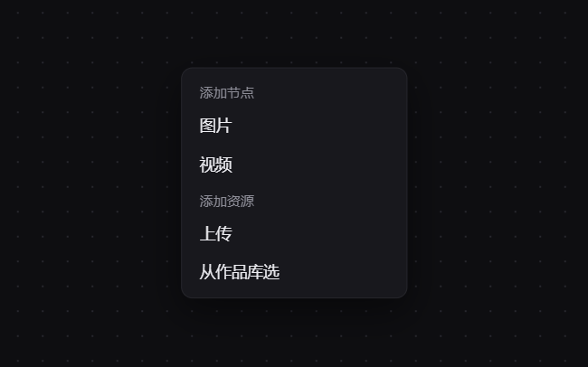
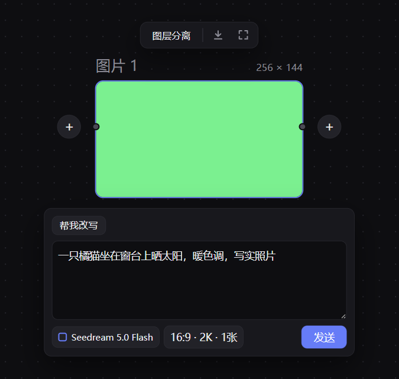
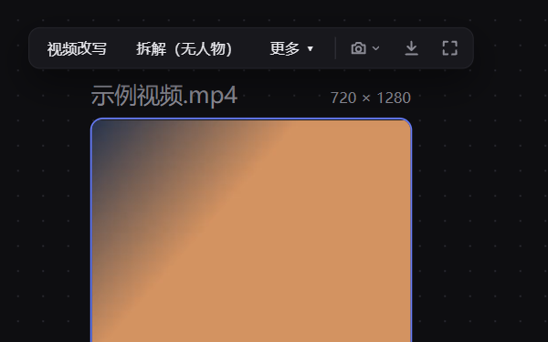
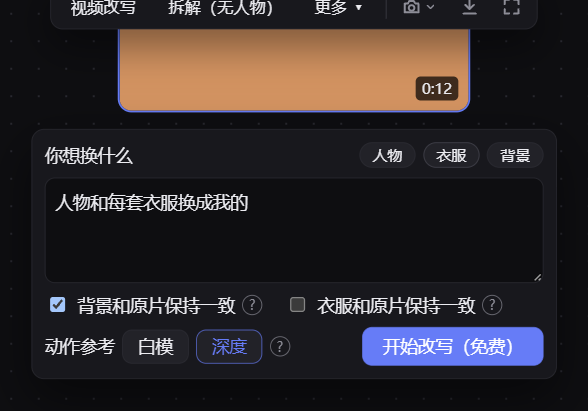
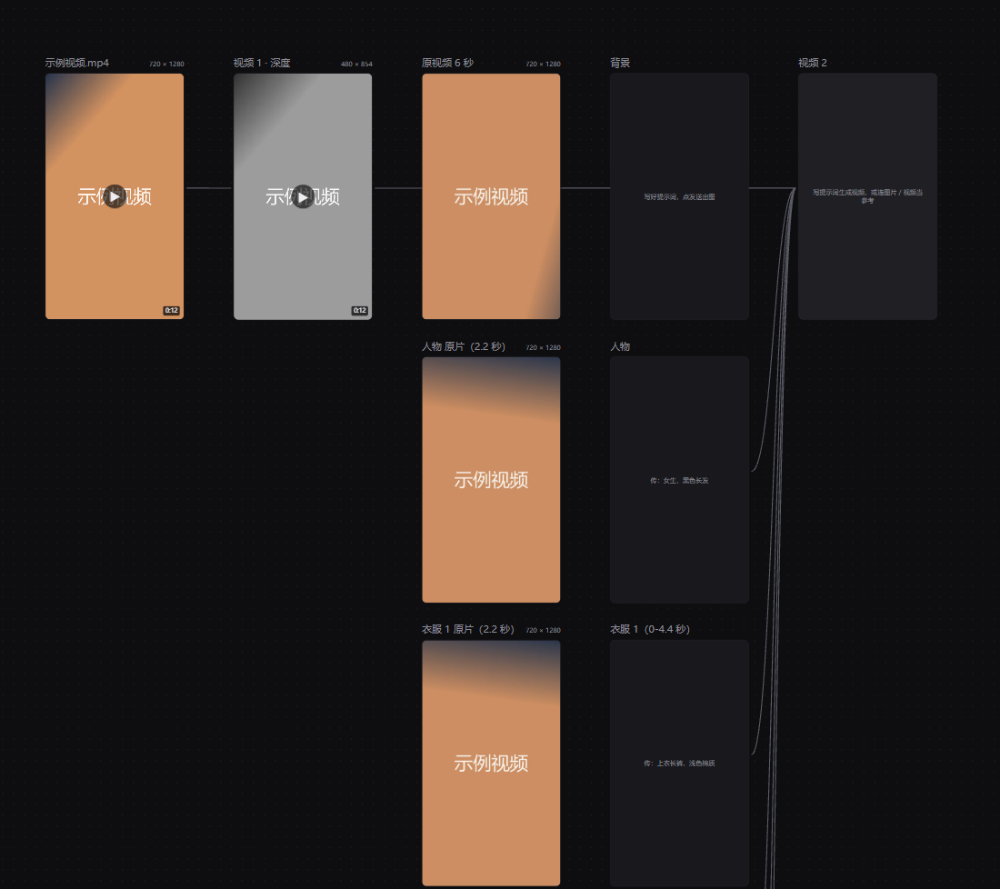
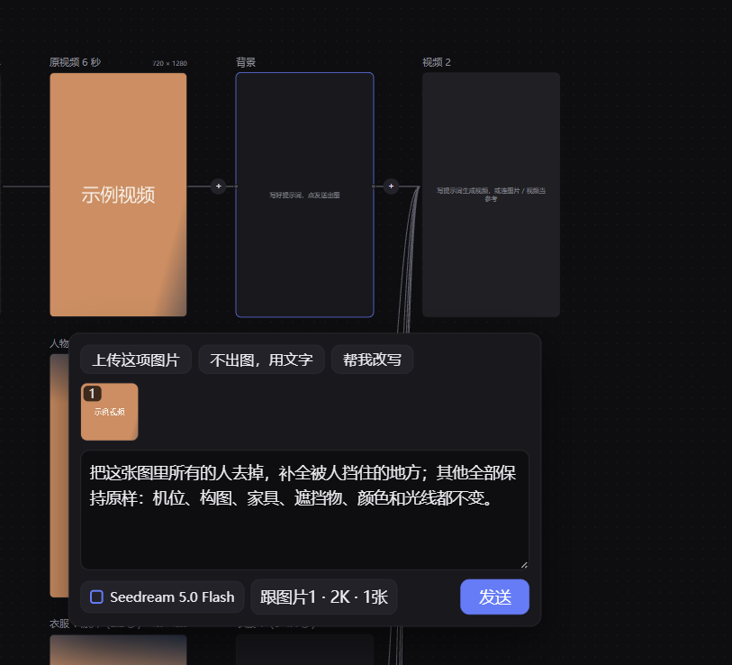
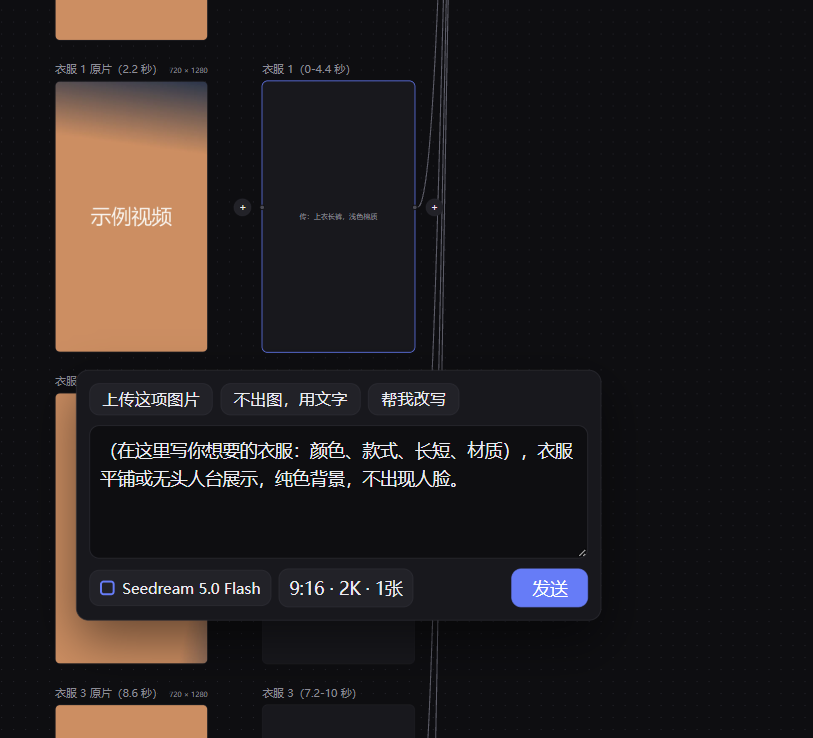
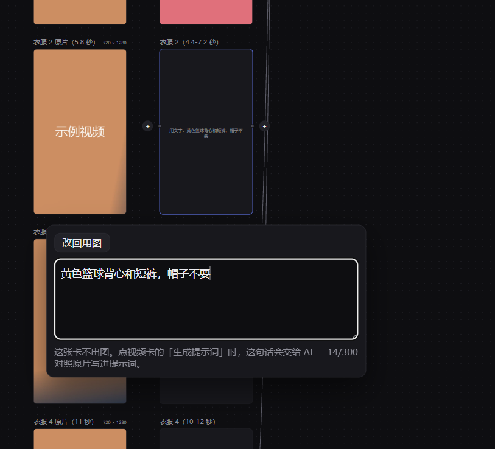
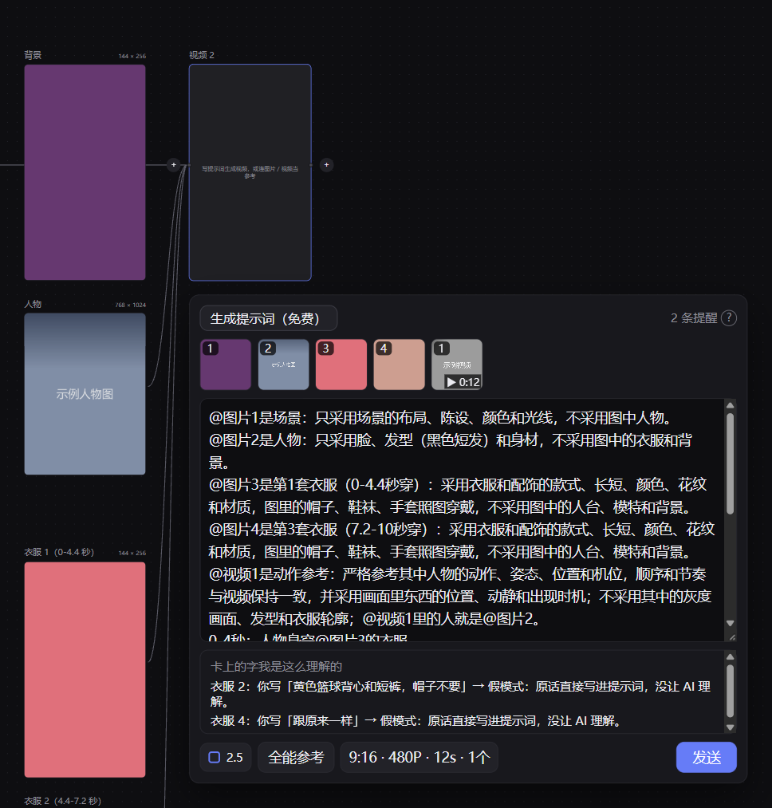
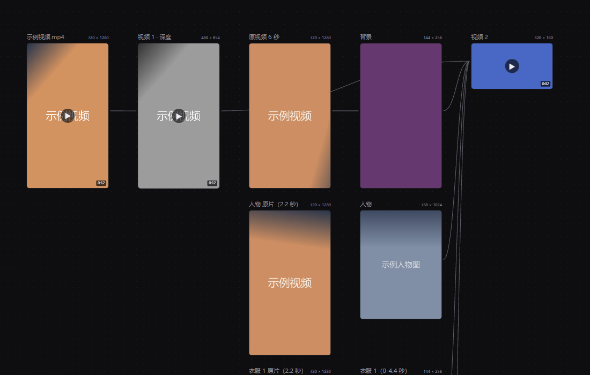

# GG TV 使用教程

装好以后怎么用，看这一篇。还没装的先看 [安装说明](安装说明.md)。

- 第一次用：按顺序看「一」「二」「三」，跟着点一遍。
- 用过了、卡在某一步：直接翻「四、不看说明不知道的规矩」和「六、常见提示是什么意思」。

> 截图是在演示模式下拍的：图片是纯色占位，视频是测试画面。你自己用的时候，这些位置是真的图和视频，按钮和步骤完全一样。

## 目录

- [一、先认识画布](#一先认识画布)
- [二、5 分钟出第一张图](#二5-分钟出第一张图)
- [三、走一遍视频改写](#三走一遍视频改写)
- [四、不看说明不知道的规矩](#四不看说明不知道的规矩)
- [五、面板选项速查](#五面板选项速查)
- [六、常见提示是什么意思](#六常见提示是什么意思)
- [七、其他功能在哪](#七其他功能在哪)

## 一、先认识画布

整个工具只有三样东西：

- **卡片**：一张图、一段视频都是一张卡。
- **连线**：从 A 卡连到 B 卡，意思是「B 生成的时候参考 A」。
- **面板**：选中一张卡，卡下面会出现一块面板，提示词、设置、**发送**按钮都在里面。

常用操作：

| 想做什么 | 怎么做 |
| --- | --- |
| 加一张卡 | 双击画布空白处 |
| 上下移动画布 | 滚轮（左右：Shift + 滚轮） |
| 放大缩小 | Ctrl + 滚轮 |
| 一眼看全 | Ctrl + 0 |
| 拖着画布走 | 按住空格拖，或按住鼠标中键拖 |
| 撤销 | Ctrl + Z |
| 删卡片 | 选中后按 Delete |
| 收起面板 / 取消选择 | Esc |

全部快捷键在页面左下角的 **快捷键** 里。

## 二、5 分钟出第一张图

1. **双击**画布空白处，弹出菜单，点 **图片**。

   

2. 画布上多了一张空卡，卡下面是面板。在输入框里写你想要的画面。
3. 面板底下一排可以换模型、换比例和清晰度，不懂就先不动。
4. 点 **发送**。这一步会向火山交单、**开始计费**。
5. 等一会儿，图出现在卡里，同时自动存进左下角的 **作品库**。

   

**想改一张已有的图**（改图）：点那张图卡右边的 **＋**，在「引用该节点生成」下面选 **图片**。新卡会自动连上原图当参考，在新卡里写「把什么改成什么」，再点 **发送**。

**想把一张已有的卡连给另一张卡当参考**：按住卡右边的 **＋** 拖出一根线，拖到目标卡**左边的小圆点**上再松手。松在别处不会连上，只会弹出菜单。

**想用自己电脑里的图**：双击空白处点 **上传**，或者直接把图片拖进画布。

## 三、走一遍视频改写

视频改写做的事：拿一段原视频，把里面的人、衣服、背景换成你的，动作和节奏跟原片一样。

### 开始前要有

- 一段 **4 到 30 秒** 的视频。
- 本机 AI 助手已经接好（没接好时点按钮会弹框告诉你缺什么）。
- 装好了深度或白模（动作参考用，见安装说明）。

### 第 1 步：上传视频

双击空白处 → **上传** → 选你的视频。选中这张视频卡，卡上方出现一排按钮。

### 第 2 步：点「视频改写」，说你想换什么

点 **视频改写**，卡下面先问「这条视频是哪种？」，点一个：

- **露脸 · 声音按原视频**（默认）：跳舞、走秀这类。出片后配回原片的声音。本节按这种讲。
- **露脸 · AI 自己配音**：口播、讲解这类。读出原片的台词，让 AI 重新说一遍、对上口型，见第 5 步后面的「会说话的视频」。
- **不露脸 · 声音按原视频**：只拍商品和手脚的带货视频。原片直接当参考，只换商品，不能换人；下面的选项会换成一个输入框。

- **输入框**：用大白话写想换什么。右上角 **人物 / 衣服 / 背景** 三个小按钮点一下会自动帮你写。
- **背景和原片保持一致**：勾上 = 背景用原片的；不勾 = 背景你自己另外准备。
- **衣服和原片保持一致**：勾上 = 你没说要换的衣服照原片来；不勾 = 衣服按你的人物图或文字来。
- **动作参考**：**深度** 或 **白模**，不知道选哪个就用默认的深度（区别见第四节第 9 条）。

写好后点 **开始改写（免费）**。这一步不花火山的钱：本机 AI 助手看一遍原片，显卡算动作参考。需要等一会儿。

### 第 3 步：卡片自动铺好，看懂每一列

从左到右：

| 列 | 是什么 | 要不要你动手 |
| --- | --- | --- |
| 原视频 | 你上传的那段 | 不用 |
| 深度（或白模） | 自动算出来的动作参考 | 不用，等它算完 |
| 原片截图（没连线的那列） | 原片里对应的画面，**只给你对照** | 不用 |
| 背景 / 人物 / 衣服 … | **要你补的卡**，一张卡一样东西 | **要** |
| 新视频卡（最右） | 成片在这里出 | 最后一步用 |

卡名后面的秒数，比如「衣服 1（0-4.4 秒）」，意思是原片里这套衣服在第 0 到 4.4 秒穿着。原片换了几套衣服，就会有几张衣服卡。

空卡上的灰字，比如「传：女生，黑色长发」，是在提醒你原片里这样东西长什么样，方便你准备对应的图。

### 第 4 步：把要补的卡一张张补上

选中一张要补的卡，面板最上面一排是三种补法，任选一种：

1. **上传这项图片**：用你电脑里现成的图。
2. **写提示词，点发送**：让 AI 出一张（花出图的钱）。
3. **不出图，用文字**：不要图，写一句话就行（人物卡没有这个按钮）。

**背景卡**（勾了「背景和原片保持一致」时）：截图已经连好，提示词也已经写好了，意思是「把图里的人去掉，其他不变」。你**直接点发送**就行。

**人物卡**：一般点 **上传这项图片** 传你自己的人物图。没有现成的图，就把输入框里括号那段换成你想要的长相，再点发送。

**衣服卡**：输入框里有一句写好的模板，把前面括号那段换成你想要的衣服（颜色、款式、长短、材质），后半句别删，再点发送。

**不想出图**：点 **不出图，用文字**，写一句大白话，比如「黄色篮球背心和短裤，帽子不要」。想跟原片一样就写「跟原来一样」。点了以后这张卡到视频卡的线会自动断开，卡面上显示你写的字。想反悔点 **改回用图**。

### 第 5 步：在新视频卡点「生成提示词（免费）」

选中最右边的新视频卡，点 **生成提示词（免费）**。本机 AI 助手会对照你补的图和原片，把整段提示词写好填进输入框，大约 1 到 2 分钟。这一步不花火山的钱。

写好以后看三处：

- **输入框里的提示词**：能看懂就扫一眼，想改可以直接改。
- **卡上的字我是这么理解的**：你用文字写的每张卡，AI 把它理解成了什么都列在这里。理解错了就回那张卡改字，再点一次生成提示词。（演示模式下这里显示的是占位说明。）
- 右上角 **N 条提醒** 旁边的 **?**：鼠标移上去，是 AI 没把握的地方，发送前看一眼。

### 第 6 步：点「发送」出片

确认面板底下的设置（模型、比例、清晰度、时长），点 **发送**。**这一步花钱最多**，发之前再看一眼。

等成片出来，它会出现在这张卡里，自动配回原片的声音，并存进作品库。

### 会说话的视频（露脸 · AI 自己配音）

口播、讲解这类视频，第 2 步选 **露脸 · AI 自己配音**，其余步骤一样，多了这几处：

- **拆解时读台词。** 本机 AI 助手看原片的字幕，把每句话、第几秒到第几秒、谁说的（出镜的人还是镜头外的人）读出来。原片没有字幕时不会瞎猜，会按有人声的时段铺好空行，你自己填字。
- **新视频卡的面板最上面多一张台词表。** 读错的字直接改；谁说、秒数也能改；能加一句、删一句。台词表里还有空着的句子时，不让生成提示词。
- **声音那一栏**：写想要的嗓音（比如「清亮自然的年轻男声，语速偏快」）；空着就由 AI 照人物图写一句。
- **生成提示词**会把每句台词原样放进 `{}` 里、按秒数排进时间轴。提示词里的台词和台词表对不上（改了台词表没重新生成、或手改提示词改丢了字），会红字提醒、不让发送。
- **发送时自动开着「生成音频」**，出片不配回原片的声音：声音和口型都是 AI 重新生成的。这种视频只在 Seedance 2.5 上真出过片。

**长视频分几段做，怎么让每段的声音像同一个人：**

1. 先做第一段，出片满意后，用 **片段截取** 从这条成片里截 5～10 秒他在说话的地方（声音样本要在 2～15 秒之间）。
2. 截出来的卡点 **更多 → 提取原声**，得到一张声音卡。
3. 右键这张声音卡 → **存为人物的声音**：选人物，写一句嗓音描述（以后每段都原样用这句）。人物库里点开人物能试听、能删；要换就再存一次。
4. 做后面几段时，把这个人物从人物库拖到新改写的 **人物** 卡上：图填进去的同时，视频卡下面会自动多一张「名字 · 声音」卡并连好，面板「声音」栏空着就自动填那句嗓音描述。
5. 点 **生成提示词**，提示词里会多一句「用这段声音的音色说话」。

声音只能做到「像」，官方说音色参考本身就有偏差，所以那句嗓音描述也一起写着、每段一字不差。

### 不满意怎么改

哪一步不满意就改哪一步：换某张卡的图或字 → 回视频卡再点一次 **生成提示词（免费）** → 再点 **发送**。每点一次发送都会再花一次钱。

## 四、不看说明不知道的规矩

1. **哪一步花钱。** 花火山钱的只有 **发送**（出图、出视频各算各的）。**开始改写（免费）**、**生成提示词（免费）**、算深度和白模都不花火山的钱，用的是你自己的 AI 助手额度和显卡。
2. **Ctrl + Enter 就是发送**，不会再问一遍，同样会花钱。
3. **线就是开关。** 连着线的卡才会被用上。鼠标移到线上会出现剪刀，点一下就剪断，剪错了按 Ctrl + Z。剪掉线的卡，它的图就不会被用上。
4. **点「背景」「衣服」小按钮，会自动取消对应的勾。** 因为你说了要换，就不能再「和原片保持一致」。只点「人物」时两个勾都留着。
5. **勾了「背景和原片保持一致」**：程序截一帧原片当背景。那一帧里没人就直接用；有人就铺一张背景卡、连好截图、写好去人的提示词，你直接点发送。**没勾**：背景卡是空的，等你上传或自己出图。
6. **勾了「衣服和原片保持一致」**：你没说要换的衣服，程序会从原片截图、铺好卡、写好提示词，你点发送就行，每套衣服算一次出图。
7. **左边没连线的截图只是给你对照的**，不参与生成，不用管。
8. **「不出图，用文字」的规矩：**
   - 背景卡、衣服卡、道具这类东西的卡可以用；**人物卡不行**，人物必须有图。
   - 一句大白话就行，最多 300 字；和原片一样就写「跟原来一样」。
   - 选了用文字却没写字，生成提示词会被拦住。
   - **至少要留一张连着图的卡**。所有卡都改成文字、一张图都没连，生成不了。
   - 生成提示词以后又改了卡上的字，面板会出红字提醒，要再点一次生成提示词。
9. **深度和白模怎么选。** 深度：连手里的东西和场景一起参考，但会把原人物的发型和衣服轮廓带过来。白模：只参考人，手里的东西和场景不管，带道具的片子选深度；白模算得慢，快慢看电脑配置。
10. **人物图怎么准备。** 程序给人物卡写好的出图模板是「单人全身正面照，穿简单的纯色贴身衣服，纯色背景」，自己传图也建议照这个样子。
11. **衣服图怎么准备。** 模板是「衣服平铺或无头人台展示，纯色背景，不出现人脸」。一套衣服一张卡。
12. **原视频太长怎么办。** 超过 30 秒用不了视频改写。选中视频卡，点工具条上的 **片段截取**，先截出一段 4 到 30 秒的再做。
13. **卡片显示「可能已建任务」时别急着重发。** 先去火山控制台的任务列表看一眼，确认没建成再发，免得花两次钱。
14. **刷新页面会丢的东西：** 「你想换什么」里还没点开始的草稿。已经铺好的卡、写好的提示词都会自动保存。

## 五、面板选项速查

**「你想换什么」面板**

| 选项 | 意思 |
| --- | --- |
| 人物 / 衣服 / 背景 | 一点就把这样东西写进输入框 |
| 背景和原片保持一致 | 勾：背景用原片的。不勾：背景你自己准备 |
| 衣服和原片保持一致 | 勾：没说要换的衣服照原片。不勾：衣服按人物图或文字来 |
| 动作参考：深度 / 白模 | 用哪种方式记住原片的动作 |
| 开始改写（免费） | 让 AI 助手看原片、铺卡，不花火山的钱 |

**要补的卡（背景 / 人物 / 衣服 …）**

| 按钮 | 意思 |
| --- | --- |
| 上传这项图片 | 用电脑里现成的图 |
| 不出图，用文字 | 这张卡不要图，写一句话（人物卡没有） |
| 改回用图 | 取消用文字，线会自动连回去 |
| 帮我改写 | 让 AI 助手把你写的提示词润色一下 |
| 发送 | 出图，花钱 |

**新视频卡**

| 按钮 | 意思 |
| --- | --- |
| 生成提示词（免费） | AI 助手对照图和原片写好整段提示词 |
| N 条提醒 ? | AI 没把握的地方，鼠标移上去看 |
| 缩略图上的 × | 断开这张参考（等于剪线） |
| 底下一排设置 | 模型、参考方式、比例 · 清晰度 · 时长 · 个数 |
| 发送 | 出视频，花钱 |

## 六、常见提示是什么意思

**「来源视频要在 4 到 30 秒之间。」**
原视频太短或太长。用工具条上的 **片段截取** 先截一段。

**「这条视频正在改写，做完再来」**
同一条视频已经在拆解了，等它铺完卡。

**「还差 N 张图：…；不想出图可以点卡上的「不出图，用文字」」**
点了生成提示词，但还有卡是空的。把提示里点名的卡补上：上传、出图，或者改成用文字。

**「XX 选了用文字，还没写字」**
那张卡点了「不出图，用文字」但输入框是空的。去写一句，或者点「改回用图」。

**「卡都改成用文字了，一张图也没连。…」**
至少要有一张连着图的卡。连一张人物图，或者选一张卡点「改回用图」。

**「XX 的字在生成提示词之后改过，再点一次「生成提示词」」**
你改了卡上的字，但提示词还是旧的。再点一次生成提示词。

**「参考图最多 N 张，请减少要换的项目」**
一次要换的东西太多，超过了模型能带的参考图数量。少写几样要换的东西，或者不勾「衣服和原片保持一致」，再点一次开始改写。

**点按钮后弹框说 AI 助手没接好**
视频改写、拆解、帮我改写都要本机 AI 助手。照弹框里说的做，接法见 [README 的「本机 AI 助手」](../README.md#本机-ai-助手内置-claude-code--codex可扩展)。

**右上角黄牌子「还没填火山 Key」 / 弹框「要先填火山 Key」 / 提示里说没填 TOS**
点弹框里的「去填 Key」、黄牌子或「设置」，在填写框里填好点保存，不用重启。还没有 Key 就把鼠标移到每个框旁边的「?」上，有步骤和网址。没填 Key 也能先用画布、上传、剪辑和视频改写的拆解、写词，到出图、出视频那一步才要。

**提示「没找到 ffmpeg」**
片段截取、视频截图、提取原声、视频改写要用它。点右上角「设置」，功能清单里那一行写着安装命令；装完关掉黑窗口，重新双击 `一键启动.bat`。

**提示里让你检查 `.env.local`**
缺深度、白模这类本机配置。照提示里列的变量名去填，填法见 [安装说明](安装说明.md)。

解决不了的，欢迎 [开 issue](https://github.com/c2247189334/ggtv-canvas/issues)，附上黑窗口里的原始报错。

## 七、其他功能在哪

这些功能还没写成一步步的教程，先告诉你入口：

| 功能 | 入口 |
| --- | --- |
| 不露脸的带货视频换商品 | 选中视频卡 → **视频改写** → 选「不露脸 · 声音按原视频」 |
| 片段截取 | 选中视频卡 → 工具条上的 **片段截取** |
| 提取原声、单独算深度 / 白模 | 选中视频卡 → **更多 ▾** |
| 视频截图（当前帧 / 首帧 / 尾帧） | 选中视频卡 → 相机图标 |
| 图层分离：把一张图拆成几层单独改 | 选中图片卡 → **图层分离** |
| 作品库、我上传的、人物 | 页面左下角 **作品库** |
| 多张画布、改名、清空 | 页面左上角画布名 |
| 密钥、深度、白模、AI 助手有没有配好 | 页面右上角 **设置** |
